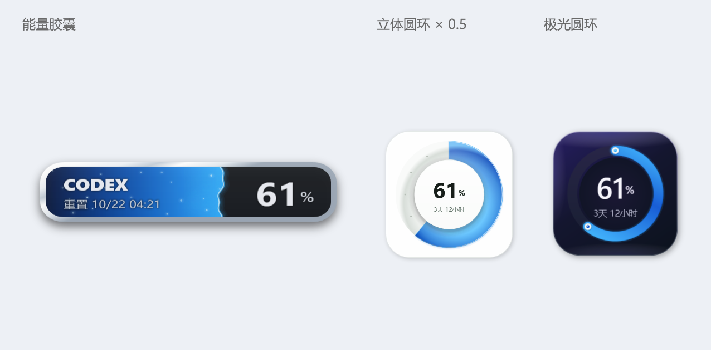
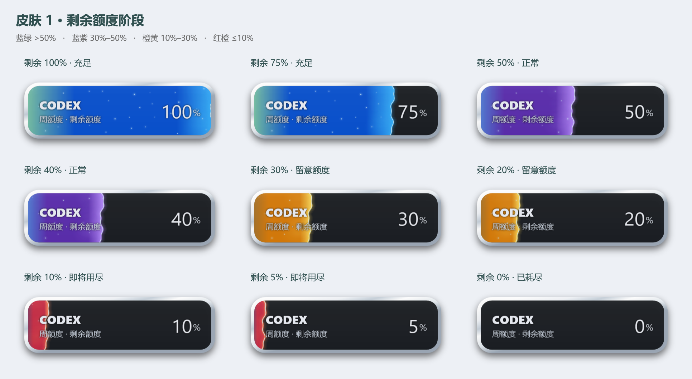

# Codex Usage Widget

A small Windows desktop widget for Codex quota, reset countdowns, and local task-completion alerts.

轻量的 Windows Codex 用量悬浮窗：显示剩余额度、重置倒计时，并在本机任务完成时让整个框体泛红发光。



## 功能

- 右键切换三种皮肤：动态能量胶囊、白色立体圆环、深紫色极光圆环。
- 白色圆环与极光圆环均为 130 × 130；支持拖动、置顶、托盘收起与记住位置。
- 每分钟读取账号真实剩余额度，按阶段变色；过期或缓存数据会标记星号。
- 圆环中心显示百分比及重置倒计时，精确到天、小时；不足一小时会明确提示。
- 本机任务完成时，整个框体（含填充区、暗色区和边框）泛红发光，3 秒后淡出。切换皮肤不会重新开始提醒计时。
- 使用已有 Codex 登录，无需填写 API Key。演示图使用虚构数值。

## 使用

1. 从 [Releases](../../releases) 下载最新版本。
2. 解压并双击 `CodexUsageWidget.exe`。
3. 右键窗口 → **皮肤** 选择外观。右键还可刷新额度、测试红光、切换置顶或退出。

需要 Windows 10/11 x64、.NET Framework 4.8，以及已经登录的 Codex 桌面应用；也支持在 `PATH` 上提供兼容的 `codex.exe`。本程序调用其 `app-server --stdio` 接口读取 ChatGPT 账号额度。

发布包为便携式 Windows x64 程序，当前未进行代码签名。

## 本地构建

使用 Windows PowerShell 或 PowerShell 7；无需 Node.js、Python、NuGet 或额外编译工具下载。

```powershell
powershell -NoProfile -ExecutionPolicy Bypass -File .\scripts\build.ps1
powershell -NoProfile -ExecutionPolicy Bypass -File .\scripts\test.ps1
```

输出位于 `bin/CodexUsageWidget.exe`。测试覆盖分色阈值、额度窗口解析、历史及重复事件过滤、日志半行写入等 14 项检查，无需登录或网络。

生成离线演示图：

```powershell
$exe = (Resolve-Path .\bin\CodexUsageWidget.exe).Path
$preview = Join-Path $PWD 'docs\skins.png'
Start-Process -FilePath $exe -ArgumentList "--demo-preview `"$preview`"" -Wait
```

### 额度阶段与任务完成效果




可用 `--stages-preview <目录>` 导出九个示例额度状态，用 `--alert-preview <目录>` 导出完成提醒的逐帧图像。这些导出使用示例额度，无需登录或联网。

## 数据与边界

- 额度数据通过 Codex 官方 [App Server 接口](https://learn.chatgpt.com/docs/app-server) 读取；账号没有返回的额度不会编造。
- 本程序不直接读取或保存登录令牌、密码或 API Key；登录由现有 Codex 客户端处理。
- 本地缓存保存额度字段与窗口设置。配置目录位于 `%LOCALAPPDATA%` 下的 `CodexUsageFloat`、`CodexUsageRing` 和 `CodexUsageAurora`。
- 完成提醒读取 `%CODEX_HOME%/sessions`（默认 `~/.codex/sessions`）中的本机会话完成事件。一次成功主任务回复回合结束视为一次完成；工具步骤、子任务、错误、历史及重复事件会被过滤。
- 未同步到本机的远程/云端任务不在完成监测范围内。应用关闭期间不监测或补发提醒。
- 会话日志格式属于 Codex 实现细节，未来升级可能需要适配。程序不会发送消息、创建任务或修改 Codex 会话。
- 程序不设置开机启动，也不控制硬件灯光。不包含遥测或第三方服务。

## 代码结构

| 文件 | 用途 |
| --- | --- |
| `src/CodexMeter.cs` | 额度接口、本地完成事件、能量胶囊及红光描边 |
| `src/RingMeter.cs` | 白色/极光圆环、重置倒计时 |
| `src/SkinController.cs` | 单窗口皮肤切换、位置与提醒状态 |
| `scripts/` | 构建与离线检查 |

## License

[MIT](LICENSE).
